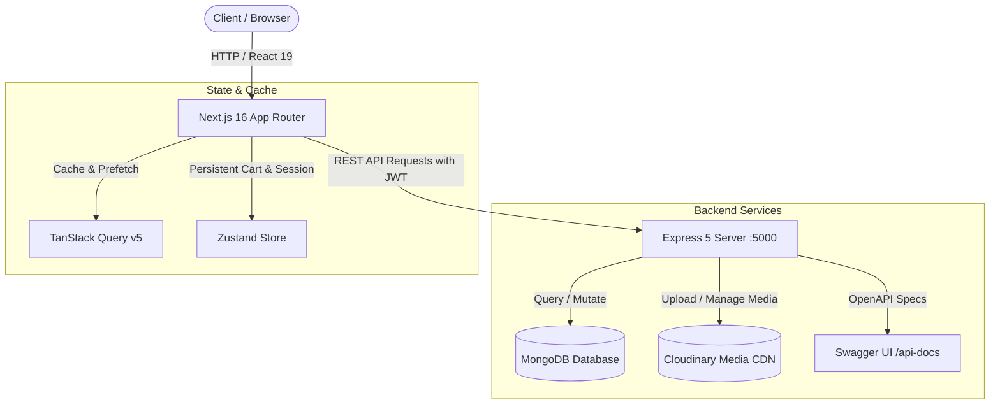

# Nexo — Luxury Full-Stack E-Commerce Platform

A production-grade, state-of-the-art full-stack e-commerce application designed with a **Dark Luxury aesthetic**. Built with a **Next.js 16** frontend and an **Express 5 + TypeScript + MongoDB** backend.

[](./frontend)
[](./frontend)
[](https://www.typescriptlang.org/)
[](./backend)
[](https://www.mongodb.com/)
[](https://cloudinary.com/)
[](http://localhost:5000/api-docs)

---

## 🏛️ System Architecture



---

## 🌟 Highlights & Key Features

### 💎 Frontend Experience (`/frontend`)
- **Luxury Obsidian & Gold Aesthetic**: Deep obsidian backgrounds (`#0f1115`) accented with rich gold (`#d4af37`), glassmorphism, and micro-interactions.
- **Sticky Interactive Gallery**: Desktop product page features a sticky gallery with vertical thumbnails, instant hover-to-switch display, and fixed aspect ratios.
- **In-Place Image Editing**: Product owners can edit individual images directly from the gallery thumbnails via an overlay trigger without navigating away.
- **Animated Modals**: Physics-based Framer Motion modals for creating, editing, and deleting products with confirmation warnings.
- **Dedicated "On Sale" Showcase**: Curated deal section on the homepage highlighting discounted products with percentage badges and computed price savings.
- **Persistent Slide-over Cart**: Real-time shopping bag powered by Zustand with quantity controls and instant subtotal calculations.

### 🛡️ Backend Engine (`/backend`)
- **JWT & Role-Based Access Control**: Secure token-based authentication with `User`, `Admin`, and `SuperAdmin` roles.
- **Product Ownership Security**: Every product is bound to its creator (`userId`). Modifying or deleting a product is enforced by `verifyProductOwner` middleware.
- **Flexible Image Storage Pipeline**: Multi-image upload to Cloudinary (up to 5 images). Supports optional image editing, individual replacement, and deletion via `existingImages` JSON.
- **Full-Text & Parametric Query Engine**: Filter by search terms (regex across title, description, and category), price ranges, stock status, ratings, and active discounts.
- **Interactive Documentation**: Live Swagger OpenAPI UI at `/api-docs` and standalone comprehensive Markdown documentation in [`backend/API-Docs.md`](./backend/API-Docs.md).

---

## 📦 Project Structure

```text
Nexo/
├── backend/                  # Express 5 REST API & MongoDB
│   ├── src/
│   │   ├── config/           # Database, Cloudinary, and Swagger configs
│   │   ├── docs/             # Swagger OpenAPI annotations
│   │   ├── middlewares/      # Auth, Multer, and Ownership middlewares
│   │   ├── modules/          # Auth, Users, and Product modules
│   │   └── app.ts            # Application bootstrap
│   ├── API-Docs.md           # Complete Markdown API documentation
│   ├── README.md             # Detailed Backend Documentation
│   └── package.json
│
├── frontend/                 # Next.js 16 Storefront
│   ├── app/                  # App Router pages (Home, Products, Globals)
│   ├── features/             # Feature slices (Products, Cart)
│   ├── _components/          # Atomic UI design system components
│   ├── lib/                  # Axios client, cookies, utilities
│   ├── store/                # Zustand global state stores
│   ├── README.md             # Detailed Frontend Documentation
│   └── package.json
│
└── README.md                 # Root Monorepo Documentation (This file)
```

---

## 🚀 Quick Start Guide

### Prerequisites
- [Node.js](https://nodejs.org/) (v18.0.0 or higher)
- [pnpm](https://pnpm.io/) (`npm install -g pnpm`)
- [MongoDB](https://www.mongodb.com/) database instance (Atlas or local)
- [Cloudinary](https://cloudinary.com/) account for image hosting

---

### 1. Backend Setup

```bash
cd backend
pnpm install
```

Create a `backend/.env` file:
```env
PORT=5000
FRONTEND_URL=http://localhost:3000
MONGO_URI=your_mongodb_connection_string
JWT_SECRET=your_jwt_secret_key
CLOUDINARY_CLOUD_NAME=your_cloudinary_cloud_name
CLOUDINARY_API_KEY=your_cloudinary_api_key
CLOUDINARY_API_SECRET=your_cloudinary_api_secret
```

Start the backend development server:
```bash
pnpm dev
```
Backend will be running at `http://localhost:5000`  
Swagger UI documentation available at `http://localhost:5000/api-docs`

---

### 2. Frontend Setup

In a new terminal:
```bash
cd frontend
pnpm install
```

Create a `frontend/.env.local` file:
```env
NEXT_PUBLIC_API_URL=http://localhost:5000
```

Start the frontend development server:
```bash
pnpm dev
```
Open [http://localhost:3000](http://localhost:3000) in your browser.

---

## 🛠️ Technology Comparison

| Category | Frontend | Backend |
| :--- | :--- | :--- |
| **Framework** | Next.js 16 (App Router) | Express 5 |
| **Language** | TypeScript (React 19) | TypeScript (Node.js ESM) |
| **Styling / UI** | Tailwind CSS v4, Lucide Icons | Helmet, CORS |
| **State / Cache** | Zustand, TanStack Query v5 | Mongoose (MongoDB ODM) |
| **Validation** | React Hook Form, Zod | Zod Runtime Schemas |
| **Media / Storage**| Local Object URLs / Previews | Multer + Cloudinary SDK v2 |
| **Documentation** | Component Docs & README | Swagger UI + `API-Docs.md` |

---

## 📖 Documentation Links

- **Interactive Swagger UI**: [http://localhost:5000/api-docs](http://localhost:5000/api-docs) (when backend is running)
- **Detailed API Documentation**: [`backend/API-Docs.md`](./backend/API-Docs.md)
- **Backend Architecture & Setup**: [`backend/README.md`](./backend/README.md)
- **Frontend Architecture & Setup**: [`frontend/README.md`](./frontend/README.md)

---

## 👨‍💻 Author

**Emad Ahmed** — Full Stack Web Developer  
- **Portfolio**: [https://emad-site.vercel.app/](https://emad-site.vercel.app/)  
- **Email**: [emadahmeddev@gmail.com](mailto:emadahmeddev@gmail.com)
